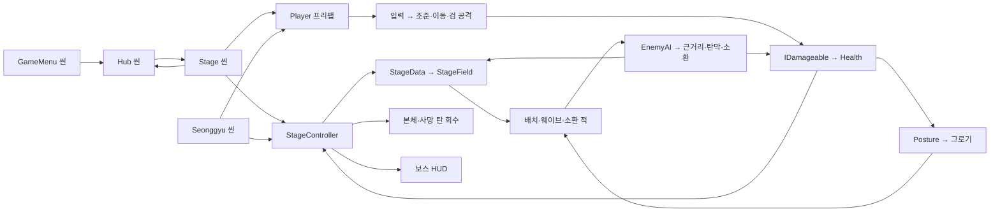

# BlueReaper 시스템 지도

작업별 문서는 [색인](INDEX.md)에서 찾는다.

## 씬과 데이터

| 씬 | 저장된 연결 |
| --- | --- |
| [GameMenu](../Assets/_Project/Scenes/GameMenu.unity) | 빌드 첫 씬이다. 타이틀·로비 uGUI와 공용 세션을 유지한다. |
| [Hub](../Assets/_Project/Scenes/Hub.unity) | 세션 시작 및 전투 복귀 시 로드한다. 스폰 지점, 이동 가능한 바닥과 경계, TopDownCamera가 있다. 화면 오른쪽 uGUI에서 스테이지 선택·준비·출발을 처리한다. |
| [Stage](../Assets/_Project/Scenes/Stage.unity) | 출발마다 로드하는 공용 전투 씬이다. Player 프리팹, StageController, TopDownCamera, 플레이어 HP와 BossHUD가 연결돼 있다. |
| [Seonggyu](../Assets/_Project/Scenes/_Sandbox/Seonggyu.unity) | Player 인스턴스의 Health, BossHUD, TopDownCamera, Stage_Dynamic과 복귀 포털이 StageController에 연결돼 있다. 중앙 입구와 준비 발판부터 동적 전투를 시작한다. |
| [Kibaek](../Assets/_Project/Scenes/_Sandbox/Kibaek.unity) | 플레이어와 타격용 더미가 배치돼 있다. StageController에 StageData가 연결돼 있지 않아 현재 필드 진행은 시작되지 않는다. |
| [Prototype](../Assets/_Project/Scenes/Prototype.unity) | 카메라와 조명이 배치돼 있다. |
| [SampleScene](../Assets/Scenes/SampleScene.unity) | [빌드 목록](../ProjectSettings/EditorBuildSettings.asset)에 남아 있다. |

## 게임 흐름

- 타이틀의 새로하기에서 로비에 진입해 Warrior 캐릭터를 생성·선택한다. 솔로는 로컬 호스트를 열고, 멀티는 2인·3인 Relay 방을 생성하거나 코드로 합류한다. 멀티는 정원을 채운 상태에서 호스트가 스테이지를 선택하고 전원이 Ready를 누르면 출발할 수 있다. 선택한 스테이지나 참가자가 바뀌면 Ready를 초기화한다.
- 호스트는 `Hub`와 `Stage`를 NGO 씬 전환으로 로드·해제한다. 씬 로드 후 참가자별 플레이어를 생성한다. 각 PC는 자기 플레이어에 카메라와 개인 HUD를 연결한다. 클리어·전멸·스테이지 중단 뒤 같은 세션의 거점으로 복귀한다. 스테이지 중 합류는 차단하고, 진행 중 참가자가 이탈하면 남은 인원은 거점으로 돌아간다. 호스트가 종료하면 참가자는 로비로 돌아간다. [GameFlow.cs](../Assets/_Project/Scripts/GameFlow/GameFlow.cs) · [StageEntry.cs](../Assets/_Project/Scripts/GameFlow/StageEntry.cs)
- 스테이지의 필드·스폰·AI·피해·처치 집계는 호스트가 진행한다. 참가자의 평타는 소유자 입력으로 요청하고 호스트에서 위치·쿨다운·생존 상태를 기준으로 처리한다. 클라이언트는 필드와 등록된 적·투사체·전조 프리팹을 표시하고 HP·실드·빈사 상태를 반영한다. 멀티 스테이지에서 사용하는 새 프리팹은 루트에 `NetworkObject`를 붙이고 네트워크 프리팹 목록에 등록한다.

## 공통 개체와 플레이어

- [Unit](../Assets/_Project/Scripts/Core/Unit.cs)은 [UnitData](../Assets/_Project/Scripts/Core/UnitData.cs)를 참조한다. [Health](../Assets/_Project/Scripts/Core/Health.cs)는 현재 체력과 피해·사망 이벤트를 관리한다. [Posture](../Assets/_Project/Scripts/Core/Posture.cs)는 선택적으로 연결되며 현재 Boss_1 프리팹에서 사용한다.
- [Player.prefab](../Assets/_Project/Prefabs/Player/Player.prefab)은 [Warrior 스탯](../Assets/_Project/Data/Players/Warrior.asset)을 참조한다. 스테이지는 씬에 있는 플레이어를 등록하고 각 필드 입구로 옮긴다.
- [PlayerInputReader](../Assets/_Project/Scripts/Player/PlayerInputReader.cs)가 이동·조준·공격·대시를 읽고, [PlayerController.Update](../Assets/_Project/Scripts/Player/PlayerController.cs)가 이동과 공격을 전달한다. [PlayerMotor](../Assets/_Project/Scripts/Player/PlayerMotor.cs)는 CharacterController로 이동하고, 대시 중 Health의 무적을 관리한다.
- [AutoAim.Resolve](../Assets/_Project/Scripts/Player/AutoAim.cs)는 조준 범위에서 보스를 우선한다. [SwordAttack.TryAttack](../Assets/_Project/Scripts/Player/SwordAttack.cs)은 쿨다운 뒤 부채꼴 안의 대상에 개체당 한 번 피해를 전달한다. 평타·조준·적 근거리·탄막은 [HurtboxTarget](../Assets/_Project/Scripts/HitBox/HurtboxTarget.cs)에서 피격용 Collider의 피해 대상을 조회한다.
- 적의 근거리·탄막과 플레이어의 검은 모두 `IDamageable`로 피해를 전달한다. 플레이어 사망 시 조작이 멈추고 스테이지가 적의 타겟 목록에서 제외한다. 피해·사망·재사용 순서는 [개체 수명 계약](contracts/UNIT_LIFECYCLE.md)을 참조한다.

## 몬스터·보스

- [Enemy](../Assets/_Project/Scripts/Core/Enemy.cs)는 등급, 페이즈, 생존 플레이어 목록을 보유한다. [EnemyAggro](../Assets/_Project/Scripts/Core/EnemyAggro.cs)는 피해 이벤트로 공격자별 수치를 기록한다. [EnemyAI](../Assets/_Project/Scripts/Boss/Patterns/EnemyAI.cs)는 공통 [타겟 선택기](../Assets/_Project/Scripts/Boss/Patterns/EnemyTargetSelector.cs)로 추격·행동 대상을 고르고, NavMesh 추적과 패턴 실행, 그로기 중단, 사망 연출을 맡는다. 일반 몬스터와 보스가 같은 AI를 사용한다.
- [Monster_1](../Assets/_Project/Data/Monsters/Monster_1_Pattern_1.asset)은 근거리, [Monster_2](../Assets/_Project/Data/Monsters/Monster_2_Pattern_1.asset)는 탄막을 사용한다. [Monster_3](../Assets/_Project/Data/Monsters/Monster_3_Pattern_Seq_1.asset)는 첫 스텝에서 전진 추적과 도약 모션을 실행하고, 다음 스텝에서 착지 위치에 전조를 표시한 뒤 원형 폭발로 자폭한다. [Boss_1](../Assets/_Project/Prefabs/Boss/Boss_1.prefab)은 자세·페이즈·시퀀스에 연결된다.
- [범위 공격 데이터](../Assets/_Project/Scripts/Boss/Patterns/AreaAttackPatternData.cs)는 스텝 시작 기준의 배치 시각과 피해 시각을 갖는다. `EnemyAI.ExecuteAreaEffects`가 시전자나 활성 필드 기준 위치를 확보하고 예약 순으로 효과를 실행한다. [AreaHitQuery](../Assets/_Project/Scripts/HitBox/AreaHitQuery.cs)는 기본 도형과 추가 도형의 피해 대상을 한 틱에 한 번씩 집계한다.
- 적의 시전, 근거리·범위 발동, 탄막 발사와 타격 연출은 각 패턴 데이터에서 지정하고 [VfxAutoDespawn](../Assets/_Project/Scripts/Vfx/VfxAutoDespawn.cs)을 통해 재생·회수한다. 피격 연출은 `TakeDamage`의 피해 적용 결과를 사용한다.
- [적 패턴 데이터](../Assets/_Project/Scripts/Boss/Patterns/EnemyPatternData.cs)의 전조 프리팹은 옵션이다. `EnemyAI.ExecutePattern`이 공격 전에 표시하고 풀에 반환한 뒤 모션과 효과의 시간을 계산한다.
- [Boss_1의 2페이즈 시퀀스](../Assets/_Project/Data/Bosses/Boss_1_Pattern_Seq_1.asset)는 패턴 1 → 2 → 4 순으로 실행한다. 스폰·사망 패턴 슬롯은 코드에 있으며, 저장된 Monster_1~3과 Boss_1 프리팹에는 할당이 없다. 각 슬롯의 실행 순서는 [적 패턴 계약](contracts/ENEMY_PATTERNS.md)을 참조한다.

## 스테이지와 회수

[StageController.RunStage](../Assets/_Project/Scripts/Stage/StageController.cs)는 선택한 StageData의 필드 프리팹을 배열 순서대로 생성한다. 현재 게임 메뉴와 Seonggyu 샌드박스는 Stage_Dynamic을 사용한다. 필드 전환과 본체·사망 탄막 회수는 [개체 수명 계약](contracts/UNIT_LIFECYCLE.md)을 참조한다.

거점의 **Select Stage Dynamic**에서 [동적 스폰 예제](../Assets/_Project/Data/Stages/Stage_Dynamic.asset)를 선택할 수 있다. 중앙 입장 후 준비 발판에서 출발하고, 처치로 공용 정화 게이지를 채운다. 최종 클리어 뒤 생존자 중앙에 포털이 열린다. 남은 적을 사냥하거나 포털을 이용해 같은 방의 거점으로 돌아갈 수 있다. 포털 개방 후 전멸해도 클리어 결과로 복귀한다. [동적 스포너](../Assets/_Project/Scripts/Stage/EnemySpawner.cs) · [동적 필드 계약](contracts/UNIT_LIFECYCLE.md#동적-스폰-필드)

### 스테이지 편집

1. Unity 메뉴에서 **Tools > BlueReaper > Stage Editor**를 열고 기존 StageData를 고르거나 새로 만든다.
2. **필드 진행 순서**에 StageField 프리팹을 추가하고 배열의 순서를 맞춘 뒤 **StageData 저장**을 누른다. 새 필드가 필요하면 Project 창에서 StageField_Dynamic을 복제한 뒤 목록에 넣는다.
3. **Prefab Mode에서 편집**을 열고 일반 적 필드의 정화 목표, 시간대 기준 처치 수, 저녁·한밤 전환 비율을 편집한다. 스포너의 반경·정원·주기 및 시간대별 웨이브는 아래에서 설정한다. 웨이브마다 일반 적 프리팹과 1회 수량, 시작 시간, 필요 시 순차 급습 간격을 지정한다. 필수 엘리트는 별도 목록에 표시되는 시간대와 총수량을 지정한다.
4. 도구에서 중앙 입구와 준비 발판을 추가한 다음 Unity SceneView에서 배치와 크기를 조정한다. 최대 3인 필드는 활성 준비 발판 3개를 사용한다. 지형을 바꿨으면 해당 프리팹에 사용할 NavMesh를 Bake하고 저장한다. 복제한 프리팹에서 지형을 바꿀 때는 원본과 별도 NavMesh 에셋을 사용한다.
5. 새 StageData에 고유한 스테이지 ID와 표시 이름을 지정한다. **스테이지 카탈로그**에 등록해 기본 개방을 켜면 거점에서 선택할 수 있다.
6. 보스 필드는 Stage Editor에서 **보스 프리팹**과 **보스 스폰 지점**을 연결한다. 지점은 **보스 스폰 지점 추가**로 만든 다음 SceneView에서 NavMesh 위에 놓고 정면을 맞춘다. 여러 보스를 순서 없이 모두 처치하는 필드는 **추가 보스 스폰**에도 프리팹과 지점을 지정한다. **동적 스포너** 연결은 비운다. 일반·엘리트 필드와 보스 필드는 같은 StageData에 순서대로 담을 수 있다.
7. 거점에서 **Select Stage BossTest**를 선택하면 보스 하나가 고정 위치에서 등장하는 [테스트 스테이지](../Assets/_Project/Data/Stages/Stage_BossTest.asset)에 출발한다.

## UI·카메라·보상·제작 도구

| 영역 | 진입점과 현재 연결 |
| --- | --- |
| HUD와 카메라 | StageEntry는 로컬 플레이어와 전투 Canvas를 연결한다. 대사·파티·일반 및 엘리트 적 표시는 [인게임 HUD 제작 가이드](IN_GAME_HUD.md)를 참조한다. [BossHUD](../Assets/_Project/Scripts/UI/Boss/BossHUD.cs)는 등록된 보스의 HP·자세를 표시한다. [TopDownCamera](../Assets/_Project/Scripts/Player/TopDownCamera.cs)는 지정된 플레이어를 따라간다. |
| 보상 | [RewardTableData.GetReward](../Assets/_Project/Scripts/Reward/RewardTableData.cs)는 합계 1000의 확률 구간에서 보상 하나를 고른다. 보스 사망 연출 완료 후 AI가 추첨하고 결과를 로그에 남긴다. 아이템 지급·인벤토리 연결은 확인되지 않았다. |
| 플레이어 VFX | [PlayerVfx](../Assets/_Project/Scripts/Player/PlayerVfx.cs)는 검 이벤트를 풀링한 궤적·타격 효과, 히트스톱과 카메라 흔들림에 연결할 수 있다. 현재 Player 프리팹과 씬에서 해당 스크립트 연결은 확인되지 않았다. |
| 탄막 제작 | [BulletPatternEditor](../Assets/_Project/Scripts/Editor/BulletPatternEditor.cs)에서 배치·경로·회차를 편집한다. 에디터와 런타임은 [BulletPatternData.TryEvaluate](../Assets/_Project/Scripts/Boss/Patterns/BulletPatternData.cs)를 공유한다. |
| 패키지와 이벤트 | CsvHelper DLL과 [Addressables 패키지](../Packages/manifest.json)가 포함돼 있다. 현재 프로젝트 스크립트의 전투·스테이지 경로에서 이를 사용하는 호출이나 `PlayerDied`·`StageCleared`의 구독은 확인되지 않았다. |

## 동작별 코드 진입점

| 확인할 동작 | 따라갈 호출 |
| --- | --- |
| 출발과 복귀 | `GameFlow` → 거점 참가자 배치 → 호스트 출발 → `StageController.TryStartRun` → `RunFinished` → 전투 씬 해제 및 거점 재입장 |
| 이동과 평타 | `PlayerController.Update` → `PlayerMotor` / `AutoAim.Resolve` → `SwordAttack.TryAttack` → `Health.TakeDamage` |
| 적 패턴 선택·실행 | `EnemyAI.AIUpdate` → `SelectNextPattern` → `ExecuteAction` → `ExecutePattern` |
| 웨이브와 소환 | `RunStage` → `SpawnWave` 또는 패턴 효과 → `SummonEnemies` → `SpawnEnemy` → `RegisterUnit` |
| 적 사망과 본체 반환 | `Health.Died` → `EnemyAI.IEDied` / `StageController.OnUnitDied` → `DeathPresentationFinished` → `ReleaseUnit` |
| 필드 종료와 사망 탄막 | 중간 필드의 전환 또는 최종 필드에서 포털 이용·패배로 전투가 종료될 때 남은 발사와 생성된 탄을 회수 |
