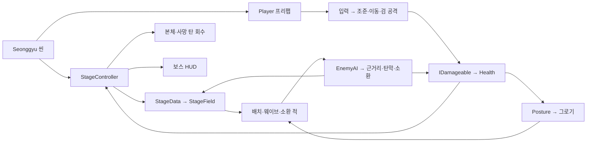

# BlueReaper 시스템 지도

기준 커밋 `29dce39`의 코드와 저장된 씬·프리팹·ScriptableObject를 대조했다. 작업별 문서는 [색인](INDEX.md)에서 찾는다.

## 씬과 데이터

| 씬 | 저장된 연결 |
| --- | --- |
| [Seonggyu](../Assets/_Project/Scenes/_Sandbox/Seonggyu.unity) | Player 인스턴스의 Health, BossHUD, TopDownCamera, Stage_1이 StageController에 연결돼 있다. 전투와 필드 진행의 진입점이다. |
| [Kibaek](../Assets/_Project/Scenes/_Sandbox/Kibaek.unity) | 플레이어와 타격용 더미가 배치돼 있다. StageController에 StageData가 연결돼 있지 않아 현재 필드 진행은 시작되지 않는다. |
| [Prototype](../Assets/_Project/Scenes/Prototype.unity) | 카메라와 조명이 배치돼 있다. |
| [SampleScene](../Assets/Scenes/SampleScene.unity) | [저장된 기본 빌드 목록](../ProjectSettings/EditorBuildSettings.asset)의 유일한 활성 씬이다. 전투와 Stage_1 연결은 Seonggyu 씬에서 확인한다. |

## 공통 개체와 플레이어

- [Unit](../Assets/_Project/Scripts/Core/Unit.cs)은 [UnitData](../Assets/_Project/Scripts/Core/UnitData.cs)를 참조한다. [Health](../Assets/_Project/Scripts/Core/Health.cs)는 현재 체력과 피해·사망 이벤트를 관리한다. [Posture](../Assets/_Project/Scripts/Core/Posture.cs)는 선택적으로 연결되며 현재 Boss_1 프리팹에서 사용한다.
- [Player.prefab](../Assets/_Project/Prefabs/Player/Player.prefab)은 [Warrior 스탯](../Assets/_Project/Data/Players/Warrior.asset)을 참조한다. 스테이지는 씬에 있는 플레이어를 등록하고 각 필드 입구로 옮긴다.
- [PlayerInputReader](../Assets/_Project/Scripts/Player/PlayerInputReader.cs)가 이동·조준·공격·대시를 읽고, [PlayerController.Update](../Assets/_Project/Scripts/Player/PlayerController.cs)가 이동과 공격을 전달한다. [PlayerMotor](../Assets/_Project/Scripts/Player/PlayerMotor.cs)는 CharacterController로 이동하고, 대시 중 Health의 무적을 관리한다.
- [AutoAim.Resolve](../Assets/_Project/Scripts/Player/AutoAim.cs)는 조준 범위에서 보스를 우선한다. [SwordAttack.TryAttack](../Assets/_Project/Scripts/Player/SwordAttack.cs)은 쿨다운 뒤 부채꼴 안의 대상에 개체당 한 번 피해를 전달한다.
- 적의 근거리·탄막과 플레이어의 검은 모두 `IDamageable`로 피해를 전달한다. 플레이어 사망 시 조작이 멈추고 스테이지가 적의 타겟 목록에서 제외한다. 피해·사망·재사용 순서는 [개체 수명 계약](contracts/UNIT_LIFECYCLE.md)을 참조한다.

## 몬스터·보스

- [Enemy](../Assets/_Project/Scripts/Core/Enemy.cs)는 등급, 페이즈, 생존 플레이어 목록을 보유한다. [EnemyAI](../Assets/_Project/Scripts/Boss/Patterns/EnemyAI.cs)는 NavMesh 추적과 패턴 선택·실행, 그로기 중단, 사망 연출을 맡는다. 일반 몬스터와 보스가 같은 AI를 사용한다.
- [Monster_1](../Assets/_Project/Data/Monsters/Monster_1_Pattern_1.asset)은 근거리, [Monster_2](../Assets/_Project/Data/Monsters/Monster_2_Pattern_1.asset)는 탄막, [Monster_3](../Assets/_Project/Data/Monsters/Monster_3_Pattern_1.asset)는 근거리 판정과 자폭을 사용한다. [Boss_1](../Assets/_Project/Prefabs/Boss/Boss_1.prefab)은 자세·페이즈·시퀀스에 연결된다.
- [Boss_1의 2페이즈 시퀀스](../Assets/_Project/Data/Bosses/Boss_1_Pattern_Seq_1.asset)는 패턴 1 → 2 → 4 순으로 실행한다. 스폰·사망 패턴 슬롯은 코드에 있으며, 저장된 Monster_1~3과 Boss_1 프리팹에는 할당이 없다. 각 슬롯의 실행 순서는 [적 패턴 계약](contracts/ENEMY_PATTERNS.md)을 참조한다.

## 스테이지와 회수

[StageController.RunStage](../Assets/_Project/Scripts/Stage/StageController.cs)가 [Stage_1](../Assets/_Project/Data/Stages/Stage_1.asset)에 지정된 필드를 순서대로 생성한다. 입구 이동·사전 배치 등록 후 첫 웨이브를 만들고, 반복 웨이브를 5초 간격으로 생성한다. 필드 전환과 본체·사망 탄막 회수는 [개체 수명 계약](contracts/UNIT_LIFECYCLE.md)을 참조한다.

| 필드 | 웨이브당 구성 | 반복 | 저장된 설정의 클리어 조건 |
| --- | --- | ---: | --- |
| [1](../Assets/_Project/Prefabs/Stage/StageField_1.prefab) | Monster_1 × 16 | 3 | 48마리 중 41마리 |
| [2](../Assets/_Project/Prefabs/Stage/StageField_2.prefab) | Monster_1 × 16, Monster_2 × 16 | 2 | 64마리 중 55마리 |
| [3](../Assets/_Project/Prefabs/Stage/StageField_3.prefab) | Monster_1 × 16, Monster_3 × 16 | 1 | 32마리 중 28마리 |
| [4](../Assets/_Project/Prefabs/Stage/StageField_4.prefab) | Boss_1 × 1 | 1 | 보스 1마리 |

## UI·카메라·보상·제작 도구

| 영역 | 진입점과 현재 연결 |
| --- | --- |
| HUD와 카메라 | [BossHUD](../Assets/_Project/Scripts/UI/Boss/BossHUD.cs)는 등록된 보스의 HP·자세를 표시한다. [TopDownCamera](../Assets/_Project/Scripts/Player/TopDownCamera.cs)는 지정된 플레이어를 따라간다. |
| 보상 | [RewardTableData.GetReward](../Assets/_Project/Scripts/Reward/RewardTableData.cs)는 합계 1000의 확률 구간에서 보상 하나를 고른다. 보스 사망 연출 완료 후 AI가 추첨하고 결과를 로그에 남긴다. 아이템 지급·인벤토리 연결은 확인되지 않았다. |
| 플레이어 VFX | [PlayerVfx](../Assets/_Project/Scripts/Player/PlayerVfx.cs)는 검 이벤트를 풀링한 궤적·타격 효과, 히트스톱과 카메라 흔들림에 연결할 수 있다. 현재 Player 프리팹과 씬에서 해당 스크립트 연결은 확인되지 않았다. |
| 탄막 제작 | [BulletPatternEditor](../Assets/_Project/Scripts/Editor/BulletPatternEditor.cs)에서 배치·경로·회차를 편집한다. 에디터와 런타임은 [BulletPatternData.TryEvaluate](../Assets/_Project/Scripts/Boss/Patterns/BulletPatternData.cs)를 공유한다. |
| 패키지와 이벤트 | CsvHelper DLL과 [Addressables 패키지](../Packages/manifest.json)가 포함돼 있다. 현재 프로젝트 스크립트의 전투·스테이지 경로에서 이를 사용하는 호출이나 `PlayerDied`·`StageCleared`의 구독은 확인되지 않았다. |

## 동작별 코드 진입점

| 확인할 동작 | 따라갈 호출 |
| --- | --- |
| 이동과 평타 | `PlayerController.Update` → `PlayerMotor` / `AutoAim.Resolve` → `SwordAttack.TryAttack` → `Health.TakeDamage` |
| 적 패턴 선택·실행 | `EnemyAI.AIUpdate` → `SelectNextPattern` → `ExecuteAction` → `ExecutePattern` |
| 웨이브와 소환 | `RunStage` → `SpawnWave` 또는 패턴 효과 → `SummonEnemies` → `SpawnEnemy` → `RegisterUnit` |
| 적 사망과 본체 반환 | `Health.Died` → `EnemyAI.IEDied` / `StageController.OnUnitDied` → `DeathPresentationFinished` → `ReleaseUnit` |
| 필드 종료와 사망 탄막 | `OnUnitDied` → `ReleaseDeathProjectiles` → `FinishField` → 다음 필드 또는 `StageCleared` |
